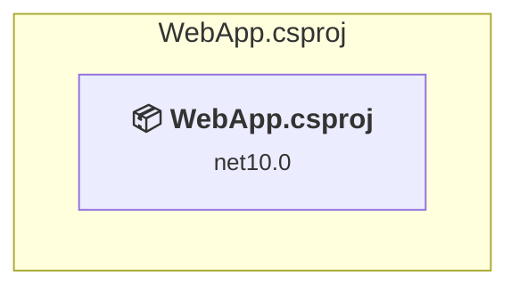

# WebApp\WebApp.csproj

[← Back to the assessment index](../../assessment.md)

## Project Info

- **Current Target Framework:** net10.0
- **Proposed Target Framework:** net11.0
- **SDK-style**: True
- **Project Kind:** AspNetCore
- **Dependencies**: 0
- **Dependants**: 0
- **Number of Files**: 34
- **Number of Files with Incidents**: 8
- **Lines of Code**: 1511
- **Estimated LOC to modify**: 48+ (at least 3.2% of the project)

## Dependency Graph

Legend:
📦 SDK-style project
⚙️ Classic project

## API Compatibility

| Category | Count | Impact |
| :--- | :---: | :--- |
| 🔴 Binary Incompatible | 1 | High - Require code changes |
| 🟡 Source Incompatible | 0 | Medium - Needs re-compilation and potential conflicting API error fixing |
| 🔵 Behavioral change | 47 | Low - Behavioral changes that may require testing at runtime |
| ✅ Compatible | 927 |  |
| ***Total APIs Analyzed*** | ***975*** |  |

## NuGet Package Issues

| Package | Current Version | Suggested Version | Severity | Issue |
| :--- | :---: | :---: | :---: | :--- |
| AutoMapper | 14.0.0 | 17.0.0 | 🔵 Optional | NuGet パッケージにセキュリティの脆弱性が含まれています |
| Microsoft.EntityFrameworkCore.SqlServer | 10.0.2 | 11.0.0 | 🟡 Potential | NuGet パッケージのアップグレードをおすすめします |
| Microsoft.EntityFrameworkCore.Tools | 10.0.2 | 11.0.0 | 🟡 Potential | NuGet パッケージのアップグレードをおすすめします |

Every project affected by these packages, and the versions the repository settles on: [aggregate NuGet packages](../nuget/aggregate-packages.md).

